# 📑 Exploratory Data Analysis & Data Cleaning Report
**Dataset:** United Nations World Population Prospects 2024 (`WPP2024_Demographic_Indicators_Medium_csv.gz` + `WPP2024_Supplement_Births_and_LE60.csv`)  
**Scope:** 237 Countries and Areas across 5 Geographic Regions and 21 Sub-Regions (1950–2100)  
**Report Location:** `eda/EDA_REPORT.md`

---

## 1. Executive Summary & Audit of Data Cleaning

### 1.1 Structural Disentanglement & Double-Counting Audit
The raw WPP 2024 Medium dataset contains **84,360 rows** across **555 distinct location entities**. A critical pitfall documented in the *Getting Started* guide is that raw records mix national entities with 318 aggregate groupings (World, Geographic regions, SDG regions, Income groups, and ad hoc political/economic alliances).
- **Double-Counting Avoidance:** A naive summation of total population across all rows in 2023 yields **360.8 billion** (~44.8× the actual global population).
- **Exact National Separation:** By filtering strictly on `LocTypeName == 'Country/Area'` and requiring a valid `ISO3_code`, exactly **237 countries/areas** are isolated (**35,787 rows** for 1950–2100).
- **Reconciliation Proof:** Summing population, births, and deaths across these 237 countries reconciles with the official UN World total with a relative discrepancy `< 3.63e-7` across all 151 years.
- **Year 2101 Truncation:** Year 2101 was removed from the active time series because only `TPopulation1Jan` was populated; all mortality, fertility, age-structure, and migration columns for 2101 were 100% missing (`NaN`).

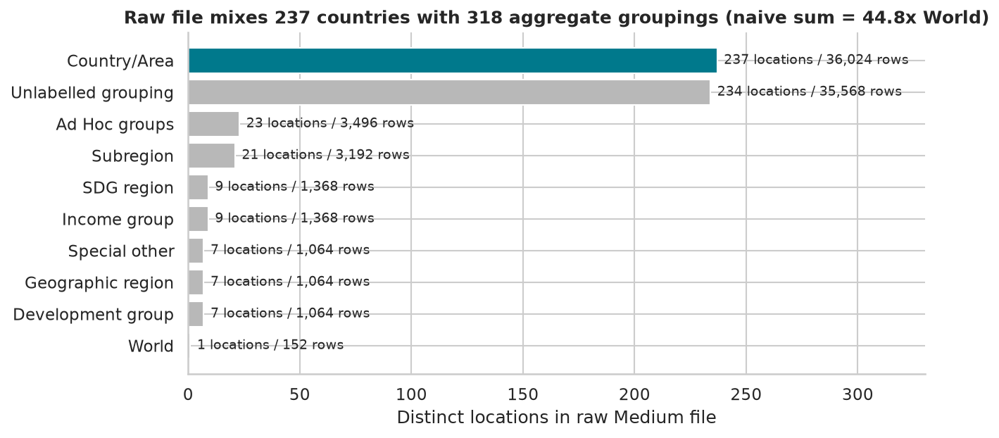

### 1.2 Region and Sub-Region Enrichment
To enable hierarchical regional analysis, the 237 countries were mapped onto the team-provided 5-Region / 21-SubRegion standard:
- **195 Primary Sovereign Nations:** Resolved through an asserted alias lookup (`eda/region_mapping.py`), correctly mapping non-standard naming (e.g., "Russian Federation" $\rightarrow$ "Russia", "Dem. People's Republic of Korea" $\rightarrow$ "North Korea", "State of Palestine" $\rightarrow$ "State of Palestine (observer state)").
- **42 Overseas Territories & Dependencies:** Systematically assigned via the UN parent identifier hierarchy (`ParentID`), ensuring zero unclassified locations.
- Mapping saved to `data/clean/country_regions.csv`.

### 1.3 Missing Values & Accounting Invariants
- **Missingness:** After dropping year 2101, all demographic indicators have **0 missing values** except:
  1. `DoublingTime` (15,938 NaNs): 100% structurally explained. 10,604 rows have population growth $\le 0$ (mathematically undefined doubling time), and 5,334 rows have near-zero growth where doubling time exceeds the UN's reporting cap (~138.4 years).
  2. `BirthsMale`, `BirthsFemale`, `LE60`, `LE60Male`, `LE60Female` (151 NaNs): Sourced from the UN supplement file; only the Holy See lacks entries (as documented by the UN).
- **Demographic Accounting Validation:**
  - $\text{Births} - \text{Deaths} = \text{Natural Change}$ ($\max |\text{error}| = 0.0$)
  - $\text{Population}_{\text{Male}} + \text{Population}_{\text{Female}} = \text{Population}_{\text{Total}}$ ($\max |\text{error}| \le 0.001\text{k}$)
  - Life expectancy bounds: $\min(\text{LExMale}, \text{LExFemale}) \le \text{LEx} \le \max(\text{LExMale}, \text{LExFemale})$ rigorously verified across all country-years.

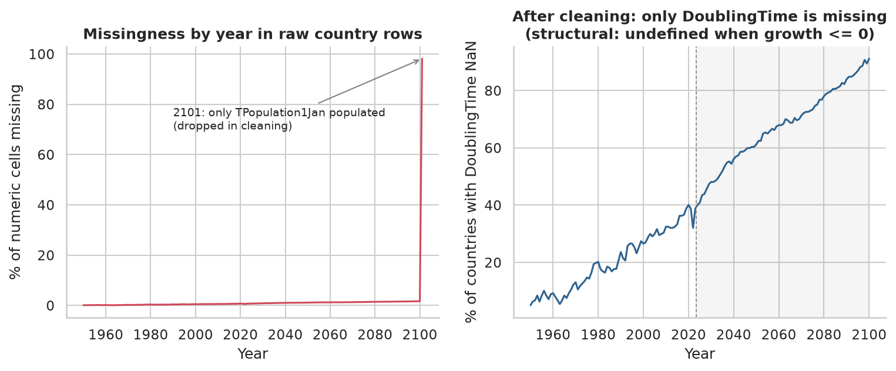

---

## 2. Key Exploratory & Statistical Findings

### 2.1 Global Demographic Transition & Turning Points
- **Peak Global Population:** Under the Medium variant, world population expands from **2.47 billion (1950)** to **8.06 billion (2023)**, peaking at **10.29 billion in 2084**, before gently declining to **10.19 billion by 2100**.
- **Geographic Center of Gravity:**
  - **Africa:** Expands from 9.1% of global population in 1950 to 18.2% in 2023, and reaches **37.4% by 2100**.
  - **Asia:** Share peaked at 60.7% in 2002 (59.1% in 2023) and declines to **45.4% by 2100**.
  - **Europe:** Contracts from 22.1% (1950) to 9.3% (2023) and down to **5.8% by 2100**.

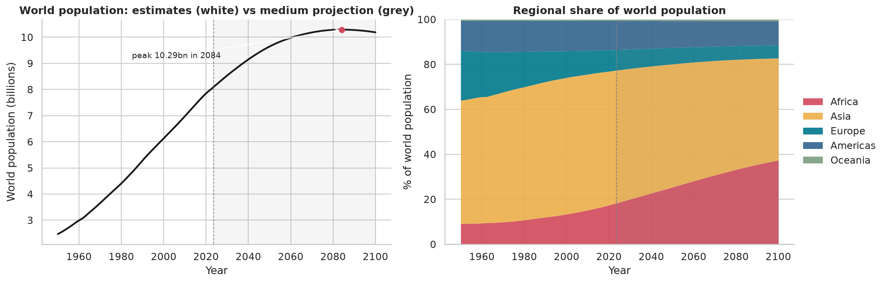
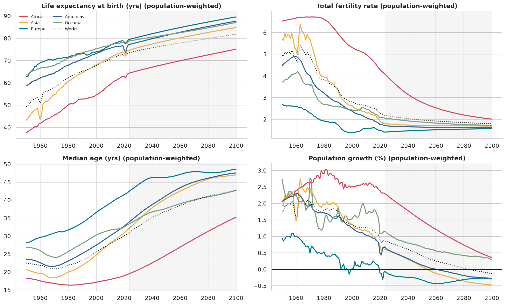

### 2.2 Shift in Cross-Country Distributions
- **Fertility Collapse & Spread:** In 1950, global TFR exhibited a bimodal distribution with a median of ~5.8. By 2023, **130 countries (representing 67.3% of the human population)** have dropped below the replacement threshold ($TFR < 2.1$). By 2100, **224 of 237 countries (87.0% of world population)** are projected to be sub-replacement. Only 13 countries (Angola, Benin, Chad, Congo, Côte d'Ivoire, DR Congo, Mauritania, Mayotte, Somalia, Sudan, Tanzania, Togo, Vanuatu; Niger crosses below replacement in 2091) are projected to remain at or above replacement by 2100.
- **Aging Divergence Before Convergence:** Cross-country standard deviation in life expectancy decreased monotonically from 11.69 years (1950) to 7.01 years (2023) and 6.49 years (2100). Conversely, cross-country divergence in **Median Age peaked in 2037** at $SD = 10.2$ years, driven by Europe and East Asia aging rapidly while Sub-Saharan Africa remains young.

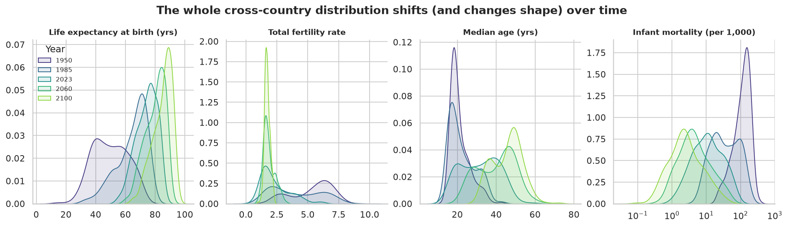
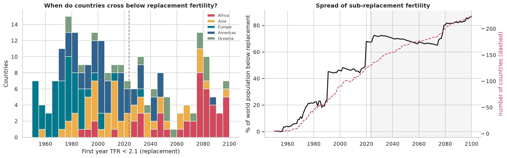
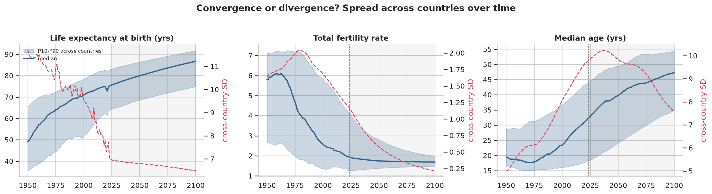

### 2.3 Bivariate Structure, Multicollinearity & Simpson's Paradox
- **Correlation Dissection:**
  - $TFR$ and $MedianAgePop$: Strongly negative pooled Spearman ($\rho = -0.91$) and within-country ($\rho = -0.71$).
  - $LEx$ and $MedianAgePop$: Strongly positive pooled ($\rho = 0.90$) and within-country ($\rho = 0.81$).
  - **Composition masks the mortality link:** Crude Death Rate ($CDR$) vs. Life Expectancy ($LEx$) is negative both between countries ($\rho_{between} = -0.27$) and within countries over time ($\rho_{within} = -0.42$), but close to zero in the 2023 cross-section ($\rho = +0.06$): aged, high-LEx populations have high crude death rates purely because of their age structure. This is not a sign flip; among the 12 core indicators the only between/within sign flip is $CDR$–$MAC$ ($-0.15$ vs. $+0.35$).
- **Multicollinearity Warning (VIF):** Regressing population growth on standard demographic indicators yields severe variance inflation (VIF: `PopGrowthRate` 731, `CBR` 482, `CNMR` 369). This is mechanical: the accounting identity $10 \times PopGrowthRate \approx CBR - CDR + CNMR$ makes these columns near-linear combinations of each other, so they must not enter one regression together. For modeling, dimensionality reduction or orthogonal components are necessary.
- **Dimensionality (PCA):** Principal Component Analysis reveals that **2 components capture 74.2% of total variance** across 12 core indicators. PC1 represents the **Demographic Transition Axis** (Median Age, Life Expectancy vs. Fertility/Mortality), while PC2 captures **Population Dynamics & Migration Intensity**.

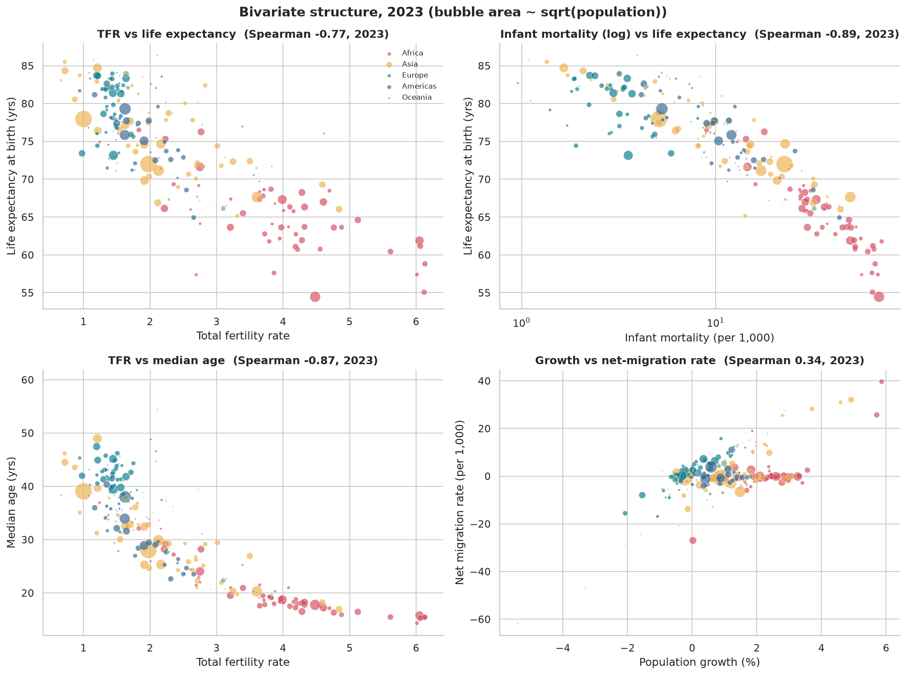
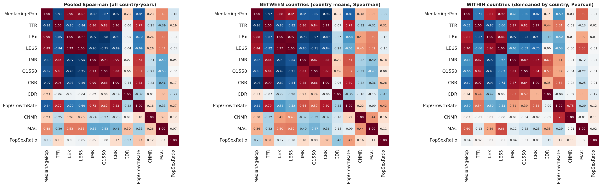
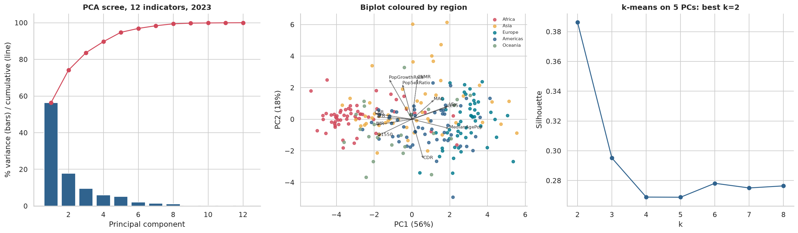

### 2.4 Demographic Shocks & Outlier Taxonomy
Historical demographic records exhibit major exogenous shocks that must be appropriately flagged rather than blindly removed:
1. **Mortality Shocks ($\Delta LEx \le -3$ years yoy):** 104 country-years identified, including the Cambodian Genocide (1975–1978, LEx dropped to 11.3 years), Rwandan Genocide (1994, LEx dropped by 30.8 years to 12.2 years), South Sudan famine/conflict (1988, LEx 11.0 years), and the 2020–2022 COVID-19 pandemic.
2. **Migration Shocks ($|CNMR| > 50$ per 1,000):** 305 country-years identified, prominent in the Gulf economies (Qatar, UAE, Kuwait) and conflict zones (Ukraine 2022 outflow of 5.7M net migrants, Syrian Arab Republic 2013).
3. **Small Population Volatility:** Micro-states with population $< 100\text{k}$ account for 37.4% of all shock flags despite comprising only 15.6% of rows.

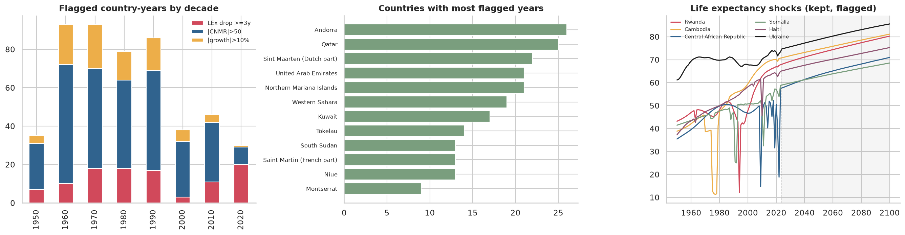
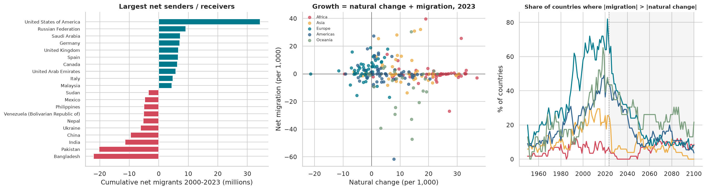

### 2.5 Estimate vs. Projection Boundary (2023 / 2024 Break)
- A critical finding for time series modeling: **Historical estimates (1950–2023)** contain stochastic annual volatility ($\text{median } |\Delta LEx| = 0.29$ years).
- In contrast, **UN Medium Projections (2024–2100)** are deterministic, smoothed model outputs ($\text{median } |\Delta LEx| = 0.16$ years, Mann-Whitney $p < 10^{-120}$).
- Caveat: the 2014–2023 window contains the 2020–2022 COVID-19 shock; using 2014–2019 the estimate-period median is 0.22 years, still above the projection's 0.16.
- 100% of countries have monotonic projected life expectancy trajectories from 2024 to 2100, compared to 0.4% in the historical record.

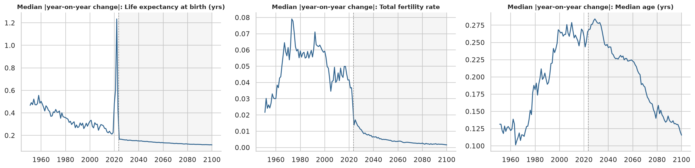

---

## 3. High-Complexity Research Questions

The following **8 medium-to-high complexity research questions** are formulated directly from our findings, designed for rigorous statistical, econometric, and time-series modeling.

```
                    ┌────────────────────────────────────────────────────────┐
                    │               PROPOSED RESEARCH THEMES                 │
                    └────────────────────────────────────────────────────────┘
                                 │
         ┌───────────────────────┼────────────────────────┐
         ▼                       ▼                        ▼
  [THEME 1: FORECASTING]   [THEME 2: ASYMMETRY]     [THEME 3: POLICY & CLUSTERING]
   RQ1: Ageing Trajectory   RQ3: Demographic Drag    RQ6: Dynamic Typologies
   RQ2: Migration Cushion   RQ4: Projection Risk     RQ7: Sex Gap Reversal
                            RQ5: Low-Fertility Trap  RQ8: Multitask Transition State
```

---

### 🔬 Question 1: Forecasting the Turning Point of Sub-Replacement Ageing
- **Core Hypothesis:** Can multivariate time series models (VAR / VECM, Vector Autoregressive Error Correction / Dynamic Factor Models) trained strictly on historical observations (1950–2000) accurately forecast the onset year of rapid population aging ($\Delta MedianAge > 0.35$ yr/yr) and peak natural growth, without incorporating future projection smoothing?
- **Methodology & Complexity:** High complexity. Requires fitting time series models on cointegrated panels ($TFR$, $LEx$, $MedianAge$, $CBR$, $CDR$), accounting for cross-country spatial/regional correlation, and benchmarking against UN Medium Variant projections (2001–2023 validation and 2024–2100 out-of-sample).

---

### 🔬 Question 2: The Migration Cushion: Offsetting Natural Population Decline
- **Core Hypothesis:** What is the critical threshold of Net Migration Rate ($CNMR$) required to prevent population decline and labor force aging across sub-replacement regimes, and which regions are structurally incapable of attracting sufficient migration?
- **Methodology & Complexity:** Medium-High complexity. Panel regression with distributed lags and regime switching (Threshold Vector Autoregression - TVAR), modeling the interaction between rate of natural change ($NatChangeRT$) and migration intensity ($CNMR$) across European, East Asian, and American sub-regions.

---

### 🔬 Question 3: The "Demographic Drag": Macro-Mortality Transitions vs. Old-Age Burden
- **Core Hypothesis:** Does the extension of life expectancy beyond age 65 ($LE65$) decouple from median age acceleration in advanced demographic transition regimes, creating a non-linear "demographic drag"?
- **Methodology & Complexity:** High complexity. Uses the newly merged supplement indicator $LE60$ alongside $LE65$ and $LE15$. Functional Data Analysis (FDA) or Generalized Additive Mixed Models (GAMM) to estimate the non-linear inflection surface where longevity gains transition from economic demographic dividend to fiscal dependency burden.

---

### 🔬 Question 4: Sensitivity & Projection Uncertainty Analysis (Using `OtherVariants`)
- **Core Hypothesis:** How sensitive are projected national timelines to variations in fertility and mortality assumptions, and which countries exhibit the widest divergence between the UN Probabilistic Prediction Intervals (80% and 95% PI) vs. deterministic variants (Constant Fertility, Zero Migration)?
- **Methodology & Complexity:** High complexity. Involves loading the supplementary 662k-row `WPP2024_Demographic_Indicators_OtherVariants_csv.gz` to quantify the fan-spread of population variance in 2050 and 2100 as a function of current development indicators and regional clustering.

---

### 🔬 Question 5: The "Low-Fertility Trap" and Rebound Dynamics
- **Core Hypothesis:** Once a nation's Total Fertility Rate drops below the "ultra-low" threshold ($TFR < 1.3$, e.g., South Korea, Singapore, Macao, Southern Europe), is there empirical evidence of endogenous self-reinforcing stagnation, or do mean age of childbearing ($MAC$) adjustments signal post-delay catch-up?
- **Methodology & Complexity:** Medium-High complexity. Non-linear panel econometric modeling (Arellano-Bond GMM or Panel Smooth Transition Autoregressive - PSTAR) testing for tempo-effect distortions vs. genuine quantum declines in fertility using $TFR$, $MAC$, and $NRR$.

---

### 🔬 Question 6: Dynamic Typology: Trajectory Clustering vs. Static Categorization
- **Core Hypothesis:** Can unsupervised longitudinal clustering (Dynamic Time Warping - DTW with k-medoids or Latent Class Growth Analysis) identify latent groups of countries whose multivariate paths through the fertility-mortality plane differ significantly from traditional UN geographic or income groupings?
- **Methodology & Complexity:** High complexity. Multi-dimensional trajectory clustering on normalized 74-year historical panels of $(TFR_t, LEx_t, CNMR_t, PopGrowthRate_t)$, identifying outlier nations that leapfrogged transition stages (e.g., East Asia) vs. those experiencing transition stalls (e.g., parts of Sub-Saharan Africa).

---

### 🔬 Question 7: The Vanishing Female Longevity Advantage: Convergence or Divergence?
- **Core Hypothesis:** Why has the male-female life expectancy gap ($\Delta LEx = LExFemale - LExMale$) compressed in developed nations over recent decades while expanding or stagnating in post-Soviet and developing nations? What explains the historical anomaly of male longevity exceeding female longevity in South Asia (Bangladesh, India, Pakistan prior to the 1990s)?
- **Methodology & Complexity:** Medium-High complexity. Two-way Fixed Effects (TWFE) and decomposition analysis of the sex differential in adult mortality ($Q1550Male - Q1550Female$) and premature mortality before age 40 ($Q0040$), examining structural shifts across decades.

---

### 🔬 Question 8: Multitask Forecasting of the Demographic Coordinate System
- **Core Hypothesis:** Can modern machine learning architectures (Multi-Output Gradient Boosted Trees, Temporal Fusion Transformers, or Neural State Space Models) jointly predict the future demographic coordinates $(TFR_{t+h}, LEx_{t+h}, PopGrowthRate_{t+h})$ with lower cumulative generalization error and superior preservation of demographic accounting identities than independent univariate models?
- **Methodology & Complexity:** High complexity. Formulates the problem under strict time-based rolling-window cross-validation (train: 1950–1995, inner-validation: 1996–2010, test: 2011–2023), evaluating identity loss penalties ($|\text{Births} - \text{Deaths} - \text{NatChange}|$) in multi-task loss functions.

---

## 4. Generated Artifacts & Datasets

All cleaning scripts, data files, tables, and figures have been generated and structured within the workspace:

| Path | Description |
|:---|:---|
| [`eda/01_clean_data.py`](01_clean_data.py) | Fully automated, asserted cleaning pipeline script |
| [`eda/02_eda_analysis.py`](02_eda_analysis.py) | Comprehensive statistical and exploratory analysis script |
| [`eda/region_mapping.py`](region_mapping.py) | Region/Sub-Region resolution module with name aliases |
| [`data/clean/wpp2024_countries_clean.csv`](../data/clean/wpp2024_countries_clean.csv) | Cleaned country-level panel (237 countries $\times$ 151 years $\times$ 75 columns) |
| [`data/clean/wpp2024_aggregates.csv`](../data/clean/wpp2024_aggregates.csv) | Separated regional/global aggregates for reference |
| [`data/clean/country_regions.csv`](../data/clean/country_regions.csv) | Master regional mapping lookup |
| [`eda/tables/`](tables/) | 13 detailed CSV/JSON summary tables & audit logs |
| [`eda/figures/`](figures/) | 20 publication-quality visualization figures (`f01`–`f20`) |
