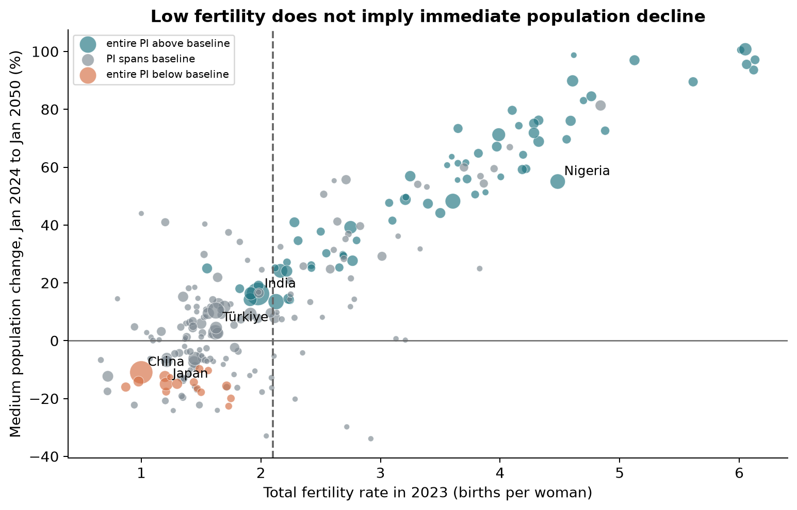
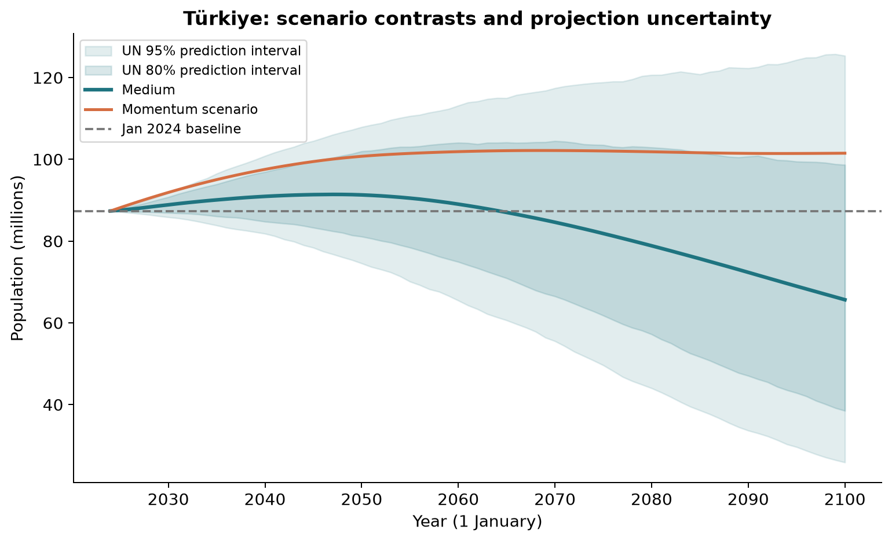

# ASA Data Quest 2026: bağımsız analiz ve sonuçlar

Bu çalışma 18 Ekim 2026 tarihinde `chatgpt` altında ham veriden yeniden kuruldu. Önceki kod ve sayısal tablolar, bağımsız sonuçların hashleri sabitlendikten sonra incelendi. İlk aşamada GitHub README özeti görüldüğü için çalışma tamamen kör sayılmaz. Başarılı hesap kontrolleri geleceğin kesin bilindiği anlamına gelmez.

## 1. Yarışma ne istiyor?

Veriden araştırma sorusu üretmek, istatistiksel olarak savunulabilir bulgular çıkarmak, görselleştirmek ve etik sonuçlarını açıkça anlatmak gerekiyor. Paylaşılan e-postaya göre giriş ve kaynakça dışında **4 içerik sayfası** ile video bağlantısı teslim edilecek. Bu pakette bu nedenle kapak + 4 içerik + kaynakça = 6 sayfa bulunuyor. Türkiye ve uluslararası değerlendirme için sunum İngilizce, açıklama raporları Türkçe hazırlandı.

E-postaya göre son tarih **31 Ekim 2026 gün sonu**, değerlendirme 1–15 Kasım. Daha eski açık duyuruda 30 Ekim ve 5 dakikalık video bilgisi bulunuyor; 31 Ekim'i e-postadan aldık ve videoyu 5 dakikanın altında hedefledik. Formun gerçek URL'si, mentor Excel'i ve takım kimlikleri bu konuşmada yok. Bu eksikler analizi engellemez, ancak nihai başvurunun tamamlandığı söylenemez. E-posta yanıtı veya başvuru gönderilmedi.

## 2. Araştırma sorusu

**2023'te düşük doğurganlığa sahip ülke ve bölgeler neden 2050'ye kadar büyüyebilir? Yaş yapısı, ölüm oranları ve göç varsayımları bu görünümü nasıl değiştirir; büyüme yönü ne kadar belirsizdir?**

2050 yakın dönem planlama ufku olarak seçildi; 2075 ve 2100 duyarlılık analizidir. Bu seçim keşifseldir, ön kayıtlı hipotez testi değildir. Türkiye yerel bağlam için örnektir; küresel sonucu yalnız Türkiye üzerinden genellemiyoruz. Yeni bir nüfus tahmin modeli eğitmedik; BM'nin mevcut modellerini karşılaştırıyoruz. Bu nedenle model tahmin başarısı veya nedensel politika etkisi iddia etmiyoruz.

## 3. Ham veri denetimi

- Dropbox'tan yeniden indirilen 6 dosya yerel kaynaklarla SHA-256 düzeyinde aynı.
- Medium: 84.360 satır, 67 sütun; 555 konum. 237 ülke/bölge ve 318 örtüşen toplulaştırılmış grup.
- 1950–2100 ülke paneli: 35.787 satır. 1950–2023 tarihsel tahmin; 2024–2100 projeksiyon.
- 2101'de yalnız 1 Ocak nüfusu var. Genel gösterge analizinden çıkarıldı, sınır stok kontrolünde kullanıldı.
- OtherVariants: 662.919 satır, 18 etiket. `Mean` nüfus serisi içermiyor; her etiket aynı değişken/yıl/konum kapsamına sahip değil. Bu 18 etiketin hepsi bağımsız olasılıklı örneklem veya eşdeğer senaryo değildir.
- Supplement: 236 ülke/bölge × 151 yıl. Holy See yok; 151 eksik satır korunuyor. Beş ek gösterge uydurulmadı.
- Ülke seçimi ISO3 varlığı ve `Country/Area` etiketiyle ayrı ayrı yapıldı ve aynı küme verdi. Altı coğrafi bölge ve dünya toplamları kaynak toplamlarıyla uyuşuyor. Northern America'nın kaynakta bulunmayan 918 üst kodu, yalnız ilgili beş üye için açıkça ele alındı.
- Nüfus ve akış birimi **bin kişi**. Grafiklerde milyon için 1.000'e, milyar için 1.000.000'a bölündü.
- `DoublingTime` eksikleri doldurulmadı. Negatif/sıfır büyüme ve çok düşük pozitif büyüme için raporlanmama durumu ayrıştırılabilir; bir yayın eşiğinin nedeni bu veri tek başına kullanılarak kanıtlanamaz.

Önemli veri sınırlılığı: `PopChange = Births − Deaths + NetMigrations` eşitliği kaynakta tam kapanmıyor. En büyük fark **4,862 bin kişi**, Ukraine 1989. Farkın nedenini belgesiz biçimde yalnız yuvarlamaya bağlamadık. Buna karşılık `Jan(t+1) − Jan(t) = PopChange` stok eşitliği sayısal hassasiyetle kapanıyor. Ayrıştırma, akış toplamı yerine stokları kullanıyor. Tüm farklar `annual_identity_residuals.csv` içinde saklandı.

## 4. Yöntem

Başlangıç P₀ = 1 Ocak 2024 nüfusu. Hedef Pₜ = 1 Ocak 2050 nüfusu. 2050 başı ile 2050 sonu aynı değildir.

Kendi hesaplarımız şu ardışık stok farklarını kullanır:

| Bileşen | Hesap |
| --- | --- |
| Momentum | Momentum(t) − P₀ |
| Mortalite | Instant replacement zero migration(t) − Momentum(t) |
| Doğurganlık | Zero migration(t) − Instant replacement zero migration(t) |
| Göç | Medium(t) − Zero migration(t) |
| Toplam | Medium(t) − P₀ |

Dört bileşenin toplamı net değişimdir. Başlangıç nüfusuna bölmek, bileşenleri başlangıcın yüzde puanları olarak verir; birbirini götüren bileşenlerde net değişime oranla oluşabilecek aşırı/kararsız payları önler. Bu matematiksel eşitliğin kapanması nedensellik kanıtı değildir.

BM senaryolarının resmi tanımı yenilenme düzeyini NRR=1 ile ilişkilendirir. Her ülkeye ve yıla sabit 2,1 çocuk dayatıldığı anlamına gelmez. Ana sınıflandırmadaki TFR<2,1 yaygın yaklaşık eşiktir; NRR<1 ile ayrıca kontrol edildi. Senaryo farkları uygulanan sıraya bağlı olabilir. Mortaliteyi aynı tutup doğurganlık ile göçün sırasını değiştiren, gerçekten kapanan ikinci bir yol da hesaplandı. Eksik faktöriyel senaryolar nedeniyle tam Shapley ayrıştırması iddia edilmedi.

## 5. Bulgular

**2023 TFR<2,1 olan 130 ülke/bölgenin 64'ü (%49,2), Medium senaryoda 1 Ocak 2050'de başlangıcından daha kalabalık.** Bu 64 birimin 2023 nüfusu, düşük doğurganlıklı grubun nüfusunun %57,7'sini oluşturuyor. Ülke sayısı ve nüfus ağırlığı farklı sorulara yanıt verir.

Daha önemli belirsizlik sonucu: Bu 64 ülke/bölgeden yalnız **6'sının** 2050 için kendi BM %95 tahmin aralığı bütünüyle başlangıç nüfusunun üstünde. Diğer **58'inde** aralık başlangıç nüfusunu kapsıyor. Bu, 58'inin kesin küçüleceği anlamına gelmez. Ayrıca 64'e ait bir güven aralığı değildir: ülke aralıkları marjinaldir; ortak örneklem yolları olmadan büyüyen ülke sayısının eşzamanlı belirsizliği hesaplanamaz. Başlangıç nüfusundaki tarihsel tahmin hatası burada ayrıca modellenmedi.

### Türkiye

| 1 Ocak 2024'ten 1 Ocak 2050'ye | Milyon kişi |
| --- | ---: |
| Başlangıç | 87.372 |
| Momentum katkısı | +13.383 |
| Mortalite katkısı | +2.807 |
| Doğurganlık katkısı | -7.634 |
| Göç katkısı | -4.617 |
| Net değişim | +3.940 |
| Medium hedef nüfus | 91.311 |
| BM %95 tahmin aralığı | 74.566–107.919 |

Türkiye için Medium değişimi **+%4.51**. 1 Ocak 2100 hedefi ise 65,667 milyon, başlangıca göre −%24,84. Aynı ülke yakın ve uzak ufukta farklı işaret verebilir. Pozitif momentum, yüzyıl boyunca kaçınılmaz büyüme anlamına gelmez. Bu WPP2024 veri sürümündeki tahminlerdir; güncel TÜİK gözlemi olarak sunulamaz.

Dünya 1 Temmuz Medium serisinin tepe yılı 2084, tepe nüfusu 10.289 milyar. Tarih etiketi açık yazıldığı sürece 1 Ocak serisiyle yapılan önceki özetin farklı başlangıç/yıl sonu nüfusları hata değildir.

### Duyarlılık

| Tanım | Asgari nüfus (bin) | Uygun düşük grup | Büyüyen |
| --- | --- | --- | --- |
| TFR<2.0 | 0 | 124 | 62 |
| TFR<2.0 | 1000 | 80 | 38 |
| TFR<2.1 | 0 | 130 | 64 |
| TFR<2.1 | 1000 | 81 | 39 |
| TFR<2.2 | 0 | 138 | 71 |
| TFR<2.2 | 1000 | 85 | 43 |
| NRR<1 | 0 | 130 | 66 |

Aynı 2023 TFR<2,1 kohortunda büyüyenlerin sayısı 2050'de 64, 2075'te 46, 2100'de 28. Kohortu hedef yılda yeniden seçmedik. NRR<1 tanımı 2050 için 66/130 sonucu verir; aynı payda aynı üyeler demek değildir. En az bir milyon nüfuslu ülkelerde TFR<2,1 sonucu 39/81 (%48,1). Düşük doğurganlık ile yakın dönem büyümenin birlikte görülebilmesi tek eşik veya küçük bölgelere bağlı değil; kesin sayılar tanıma bağlı.

Türkiye'nin 2050 göç katkısı, doğurganlık/göç sırası değiştirilince yaklaşık 0,464 milyon değişiyor. Bu iki bileşenin ayrı paylarının model yolu seçimine duyarlı olduğunu gösterir. Grafik/tablolar bu farkı görünür kılar.

## 6. İstatistiksel yorumun sınırları

Ülke-yıllarını bağımsız rastgele örneklem sayıp çok küçük p değerleri üretmedik. Projeksiyonların düzgünleşmesi bilinen model yapısının bir sonucudur; gerçek dünyada bir müdahalenin etkisini kanıtlamaz. BM'nin yayımladığı %80/%95 aralıklar model varsayımlarına koşulludur. High/Low deterministik doğurganlık senaryoları bu aralıkların yerine geçmez. Ülkelerin alt/üst sınırları toplanarak dünya aralığı üretilmedi. Momentum ve bileşen farklarına, ortak simülasyon örneklemleri bulunmadığı için uydurma güven aralığı çizilmedi.

Doğurganlık, yaşam beklentisi ve medyan yaşın nüfus ağırlıklı ülke ortalaması resmi dünya göstergesinin aynısı değildir. Bu çalışmada dünya göstergesi gerektiğinde BM World satırı kullanılır. Yaş grupları, istihdam ve mali veriler olmadan emeklilik yükü veya işgücü etkisi ölçülmüş gibi gösterilmez.

## 7. Etik ve kullanım

Ülkeler/bölgeler küçük bir toplulukla büyük bir devleti aynı sayım birimi içinde tutar; bunun sonuçlara etkisi ayrıca raporlandı. Coğrafi sınıflamalar hukuki statü değerlendirmesi değildir. Göç ve doğum tercihleri burada politik hedef veya nüfusların değeri için ölçü değildir. Veri revizyonu, savaş/göç koşullarında ölçüm zorluğu ve model yanlılığı sonuçları etkileyebilir. Yapay zekâ kod, kontrol ve metin üretiminde kullanıldı; takımın yöntem ve sonuçları anlaması, katkıları açıklaması ve yarışma kurallarına uygunluğu kontrol etmesi gerekir.

## 8. Doğrulama ve yeniden üretim

Bağımsız ana hat 89 veri ve hesap kontrolünden geçti. İkinci uygulama `csv`, `gzip` ve `Decimal` ile 747.279 satırı tarayıp 11.100 bileşen değerini ve üç ufuktaki kohort sayılarını doğruladı. Önceki temiz dosyayla 59 ortak sayısal sütunda 2.111.433 değer aynı; eksik deseninde fark yok. Önceki ana log ayrıştırması kendi 2101 sınır tarihinde tekrar hesaplanınca en büyük hata 2,22e−16. Önceki dört betik ayrı kopyada çalıştırıldı ve 27 CSV/JSON tablo byte düzeyinde yeniden üretildi.

Bu kontroller ham verinin geleceğe ilişkin varsayımlarını kanıtlamaz. Desteklenmeyen “her şey kesin doğru” sözü yerine hangi kontrolün neyi kapsadığı kaydedildi. Ayrıntılı yorum/kod sorunları için [DENETIM.md](DENETIM.md), çalıştırma için [README](../README.md), kaynaklar için [KAYNAKLAR.md](KAYNAKLAR.md).
